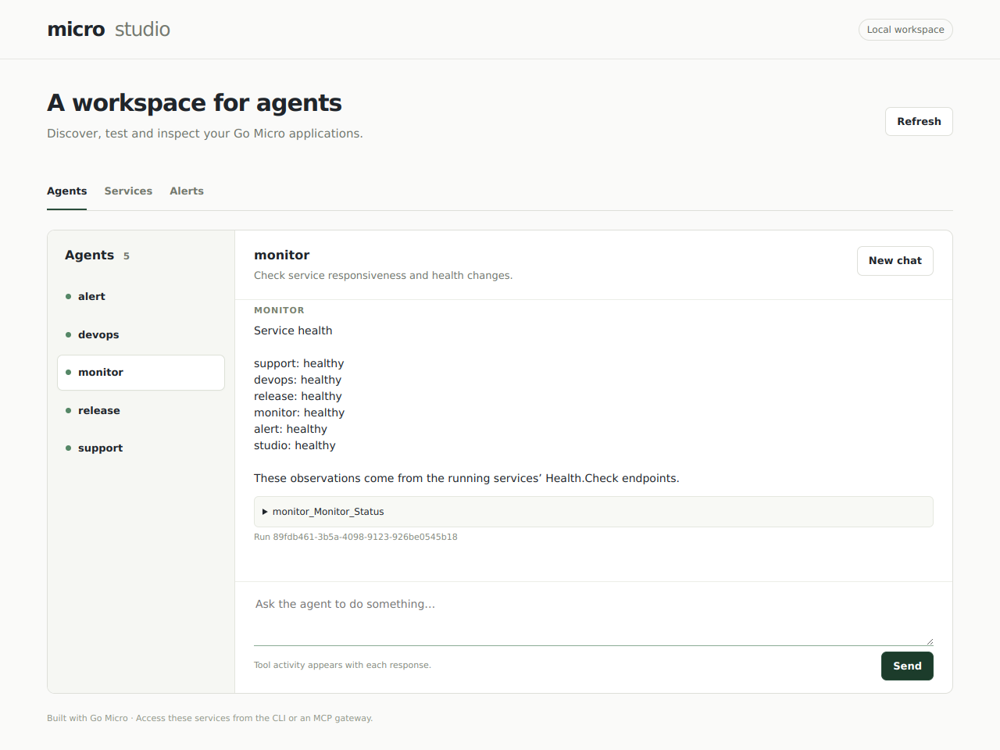

# Micro Studio

A workspace for agents.

Self-hosted and built with [Go Micro](https://github.com/micro/go-micro).



*Local run with a test model and health observations from live services.*

## Features

- **Agent chat:** talk to discovered agents and inspect their tool calls and results.
- **Service discovery:** see running services, instances, endpoints and schemas.
- **Health monitoring:** check service responsiveness and record changes.
- **Alerts:** track incidents, recovery and notification delivery.
- **Extensible:** connect existing Go Micro applications through the same registry.
- **CLI and MCP:** use the same agents from `micro chat` or expose them through the gateway.

Includes [Support](support), [DevOps](devops), [Release](release),
[Monitor](monitor) and [Alert](alert). Monitor and Alert work in the background
without model calls.

## Run

Requires Go 1.26 or newer, with Go's bin directory on your PATH.

```sh
go install go-micro.dev/v6/cmd/micro@master
git clone https://github.com/micro/studio
cd studio

export MICRO_AI_PROVIDER=openai
export MICRO_AI_API_KEY=your-model-key
micro run
```

Open **http://localhost:8080** and select an agent. To use the CLI, run
`micro chat` in another terminal with the same model and registry settings.

Studio currently runs locally for one operator. Chat responses and tool results
appear when a request finishes; reloading starts a new conversation. Interactive
Release approvals use the CLI. See [deployment](deploy) for server setup, SSH
access, configuration and MCP exposure.

## Extend

Write services and agents using Go Micro. Run them with Studio's registry and
they appear automatically. Add local programs to `micro.json` to start them with
`micro run`. Reusable integrations live in `services/`.

To run only the workspace against existing services: `go run ./cmd/studio`.
Studio identifies agents by `Agent.Chat`; Monitor checks its configured service
set. Studio does not yet manage agent definitions, credentials or deployments.

## Development

```sh
go test -race ./...
go build ./...
```

With `micro` and `nats-server` installed, `python3 scripts/smoke.py` tests startup,
web chat, CLI delegation and failure/recovery alerts using local fixtures.
Set `MICRO_BIN` to select a CLI binary.

Licensed under AGPL-3.0; see [LICENSE](LICENSE).
